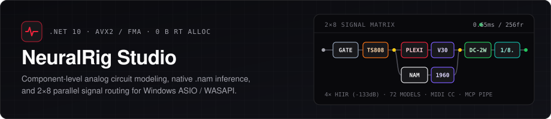

<div align="center">

<picture>
  <source media="(prefers-color-scheme: dark)" srcset="docs/assets/banner-dark.svg" />
  <source media="(prefers-color-scheme: light)" srcset="docs/assets/banner-light.svg" />
  
</picture>

<br />

[](https://github.com/srain0626/NeuralRigStudio)
[](https://dotnet.microsoft.com/)
[](#실시간-성능-벤치마크-rigbench)
[](#오디오-io-midi-제어-및-계측-도구)
[](#시스템-아키텍처-및-스레딩-모델)
[](#model-context-protocol-mcp-서버)
[](LICENSE)

[English](README.md) · **한국어**

[아키텍처](#시스템-아키텍처-및-스레딩-모델) · [DSP & 신경망 엔진](#dsp-및-신경망-추론-내부-구현) · [벤치마크](#실시간-성능-벤치마크-rigbench) · [디바이스 카탈로그](#디바이스-카탈로그-72종) · [오디오 · MIDI · 계측](#오디오-io-midi-제어-및-계측-도구) · [MCP 서버](#model-context-protocol-mcp-서버) · [소스 빌드](#소스-빌드-및-배포)

</div>

---

**NeuralRig Studio**는 순수 C# (`.NET 10`, `System.Runtime.Intrinsics.X86` AVX2/FMA)과 WebView2 / React 19 프론트엔드로 구현된 실시간 기타 멀티이펙터, 화이트박스 아날로그 회로 시뮬레이터 및 Neural Amp Modeler(`.nam`) 워크스테이션입니다.

4× 폴리페이즈 하프밴드 오버샘플러, 감쇠 뉴턴-랩슨(Damped Newton-Raphson) 기반 반도체 소자 해법, 다단 12AX7 진공관 프리앰프, KCL 기호해석 패시브 톤스택, 스테레오 SIMD 캐비닛 IR 컨볼버, 그리고 `Vector256<float>` 신경망 추론 런타임(`WaveNet`, `LSTM`, `ConvNet`)까지 모든 오디오 커널이 외부 C++/ONNX 래퍼나 별도 Python 사이드카 없이 단일 매니지드 런타임 위에서 구동되며, 실시간 오디오 콜백 스레드에서 **블록당 `0 B` 힙 할당(`RT alloc: 0 B`)** 불변 조건을 유지합니다.

---

## 핵심 설계 요약

- **실시간 오디오 콜백 무할당(`0 B / block`)**: 딜레이 라인, 오버샘플러 상태 배열, 바이쿼드 필터, 컨볼루션 히스토리, 신경망 워크스페이스를 모두 `Prepare()` 단계에서 사전 할당합니다. UI 조작·MIDI CC·프리셋 전환은 비실시간 스레드에서 평탄화된 불변 스냅샷(`CompiledSnapshot`)으로 컴파일된 뒤 `Volatile.Write` / `Volatile.Read` 원자적 참조 교체로 반영되므로 오디오 콜백 내 `lock`, GC 일시정지, 지퍼 노이즈가 발생하지 않습니다.
- **2×8 병렬 매트릭스 및 8개 무소음 Scene (`A–H`)**: 2열 × 8슬롯(총 16블록) 구조에서 직렬 체인(`Row 1 → Row 2`)과 가변 분기/합류 병렬 라우팅(`splitCol` / `mergeCol`, 병렬 웨트/드라이 믹스)을 지원합니다. 독립된 듀얼 앰프·듀얼 캐비닛 상태 풀과 프리셋당 **최대 3개의 동시 독립 `.nam` 캡처 슬롯**을 제공합니다.
- **소자 단위 아날로그 회로 모델링 (72종)**: 정적 `tanh` 근사 대신 Shockley 다이오드 물리 방정식(`1N914 Si`, `1N34A Ge`, `Red LED`, 비대칭 3-다이오드 피드백), `2N7000` MOSFET, `2SK30A / J201` JFET, `OC44 / 2N5088` BJT, `LM308` 슬루레이트 제한, 12AX7 그리드 전도 바이어스 시프트, 4-노드 FMV 패시브 톤스택, 푸시풀 파워앰프 `B+` 전원 새그(Sag) 및 부궤환(`NFB`) `Presence` / `Depth` 회로를 직접 계산합니다.
- **네이티브 `.nam` 신경망 런타임 (`WaveNet` / `LSTM` / `ConvNet`)**: 공식 Neural Amp Modeler 포맷의 `Nano`, `Feather`, `Standard` WaveNet 및 LSTM, ConvNet 아키텍처를 순수 C# AVX2/FMA 벡터 연산으로 실시간 추론하며 비트 단위 무손실 `.nam` 직렬화 왕복을 검증합니다.
- **이종 클럭 오디오 브리지, 하드웨어 MIDI 및 템포 싱크**: ASIO 단일 풀듀플렉스, ASIO 입력 → WASAPI 출력(공유/단독 모드, MMCSS `"Pro Audio"` 우선순위), 듀얼 ASIO 교차 라우팅과 `44.1 kHz ↔ 48 kHz` 무할당 Sinc 샘플레이트 브리지를 내장합니다. WinMM 하드웨어 MIDI CC/PC 및 원클릭 **MIDI Learn**, 글로벌 BPM 박자 분할 동기화(`1/4`, `1/8.`, `1/8`, `1/8T`, `1/16`), 락프리 MR 백킹 트랙 루프 믹서를 포함합니다.
- **기타 DI 음향 프로파일러 & 프로세스 분리형 MCP 서버**: 6단계 가이드 측정으로 노이즈 플로어·60 Hz 험·배음 구조를 정밀 계측하는 DI 프로파일러, McLeod Pitch Method(`NSDF`) 기반 `±0.5 ct` 크로매틱 튜너, 그리고 Windows Named Pipe(`\\.\pipe\NeuralRigStudio_McpPipe_v1`)로 통신하는 단독 실행형 stdio MCP 서버(`NeuralRigMcp`)를 탑재했습니다.

---

## 시스템 아키텍처 및 스레딩 모델

실시간 오디오 스레드가 UI 렌더링, 가비지 컬렉션, IPC 직렬화 또는 커널 뮤텍스에 블로킹되면 즉시 오디오 드롭아웃(xrun)으로 이어집니다. NeuralRig Studio는 실행 컨텍스트를 3개 계층으로 엄격히 분리하고, 계층 간 데이터 교환에는 2의 거듭제곱 크기 SPSC(Single-Producer/Single-Consumer) 락프리 링 버퍼와 원자적 스냅샷 포인터만 사용합니다.

```text
┌──────────────────────────────────────────────────────────────────────────────────────┐
│ 1. 외부 프로세스 & 프론트엔드 계층                                                   │
│                                                                                      │
│   ┌─────────────────────────────────────┐    ┌────────────────────────────────────┐  │
│   │ WebView2 Frontend (React 19 + TS)   │    │ NeuralRigMcp.exe (단독 프로세스)   │  │
│   │ 2x8 매트릭스 · Scene A-H · 50fps 뷰 │    │ Stdio JSON-RPC 2.0 <-> AI 에이전트 │  │
│   └──────────────────┬──────────────────┘    └─────────────────┬──────────────────┘  │
└──────────────────────┼─────────────────────────────────────────┼─────────────────────┘
                       │ window.chrome.webview JSON              │ \\.\pipe\NeuralRigStudio_McpPipe_v1
                       ▼                                         ▼
┌──────────────────────────────────────────────────────────────────────────────────────┐
│ 2. 호스트 제어 계층 (WinForms STA + WinMM MIDI + 백그라운드 I/O)                     │
│                                                                                      │
│   RigWebBridge <── MidiRouter (CC / PC / MIDI Learn / 140ms 디바운스 / 4-Tap BPM)    │
│        │                                                                             │
│        ├─ GuitarAnalyzer (6단계 DI 보정 마법사, 8192-pt FFT 배음 빗살 분석)          │
│        ├─ AntigravityToneArchitect (기타 프로파일 반영 16슬롯 + 8씬 자동 설계)       │
│        └─ SignalChainEngine.UpdateChain() -> 평탄화된 CompiledSnapshot + NAM 컴파일  │
└──────────────────────┬─────────────────────────────────────────▲─────────────────────┘
                       │ Volatile.Write(CompiledSnapshot)        │ 락프리 Dry/Wet 탭
                       ▼                                         │ SPSC RingBuffer (8192)
┌────────────────────────────────────────────────────────────────┴─────────────────────┐
│ 3. 실시간 오디오 콜백 (ASIO 드라이버 콜백 / WASAPI MMCSS "Pro Audio")                │
│    불변 조건: 0 B 힙 할당 · 무잠금(Lock-Free) · 전 버퍼 사전 할당                    │
│                                                                                      │
│   ASIO 입력 ─► [44.1k<->48k Sinc 브리지] ─► Dry 탭 ─► ToneProcessor                  │
│                                                       ├─ 2x8 SignalChainEngine       │
│                                                       ├─ 4x HIIR + WhiteBox / 페달   │
│                                                       ├─ AVX2/FMA NamWorkspace[0..2] │
│                                                       └─ Stereo Cab IR 컨볼버        │
│                                                                │                     │
│   ASIO / WASAPI 출력 ◄── Wet 탭 ◄── [락프리 MR 백킹 믹서] ◄────┘                     │
└──────────────────────────────────────────────────────────────────────────────────────┘
```

### 솔루션 및 디렉터리 구조

핵심 DSP 커널은 Windows 데스크톱 UI(`WinForms` / `WebView2`) 의존성을 완전히 제거한 `src/NeuralRig.Core` (`net10.0`) 어셈블리로 분리되어 있으며, 벤치마크 러너(`RigBench`)와 MCP 어댑터(`NeuralRigMcp`)가 동일한 코어를 직접 참조합니다.

```text
NeuralRigStudio/
├── NeuralRigStudio.sln
├── NeuralRigStudio.csproj              # Windows x64 데스크톱 호스트 (WinForms + WebView2 + ASIO/WASAPI)
├── MainForm.cs / Program.cs            # PerMonitorV2 고해상도 DPI 창 및 WebView2 수명주기 관리
├── Audio/
│   └── AudioRouter.cs                  # ASIO 풀듀플렉스, 범용 WASAPI 캡처, 듀얼 ASIO, MR 믹서
├── Services/
│   ├── RigWebBridge.cs                 # WebView2 JSON 브리지 및 Named Pipe 서버 (McpPipe_v1)
│   └── MidiRouter.cs                   # WinMM MIDI CC/PC 수신, MIDI Learn 및 탭 템포 계산
├── src/
│   └── NeuralRig.Core/                 # UI 비의존 순수 DSP & 신경망 코어 라이브러리 (net10.0)
│       ├── Audio/
│       │   ├── SignalChainEngine*.cs   # 2x8 모듈러 매트릭스, 직병렬 라우팅 및 72종 블록 커널
│       │   ├── SchematicPedalDsp.cs    # 4x HIIR + Shockley 뉴턴-랩슨 페달 회로 해석기
│       │   ├── WhiteBoxAmpEngine.cs    # 12AX7 다단 진공관, KCL FMV 톤스택, 파워앰프 새그
│       │   ├── NamRuntime.cs           # AVX2/FMA WaveNet, LSTM & ConvNet .nam 추론 엔진
│       │   ├── PartitionedConvolver.cs # 무지연 분할 FFT 컨볼버 (최대 16,384탭 풀-렝스 IR)
│       │   ├── CabinetIrBank.cs        # 내장 실측 WAV IR 뱅크 및 듀얼 가상 마이킹 합성기
│       │   ├── SincResampler.cs        # Blackman-Harris 윈도우 Sinc 리샘플러
│       │   ├── GuitarAnalyzer.cs       # 6단계 기타 DI 분석기 및 픽업 자동 분류기
│       │   ├── GuitarPitchDetector.cs  # McLeod Pitch Method (NSDF) 기본주파수 추적기
│       │   ├── VisualizerAnalyzer.cs   # Radix-2 FFT 스펙트럼 및 텔레메트리 스냅샷 생성기
│       │   └── RingBuffer.cs           # 2의 거듭제곱 크기 스테레오 SPSC 락프리 링 버퍼
│       └── Services/
│           └── AntigravityToneArchitect.cs
├── web-ui/                             # React 19 + TypeScript + Vite + Tailwind CSS v4 콘솔 UI
├── Assets/CabIRs/                      # 실제 마이크(SM57/SM7B 등)로 수음된 7종 캐비닛 WAV IR
├── tools/
│   ├── NeuralRigMcp/                   # 단독 실행형 stdio MCP 서버 및 CLI 점검 도구
│   └── RigBench/                       # 36개 항목 DSP 정밀도 및 RT 무할당 검증 스위트
└── docs/                               # 아키텍처, 계측 알고리즘, MCP 프로토콜 상세 문서
```

---

## DSP 및 신경망 추론 내부 구현

### 1. 2단 4× HIIR 폴리페이즈 올패스 오버샘플러

비선형 클리핑 단에서 발생하는 나이퀴스트 이상의 고조파 에일리어싱(aliasing)을 억제하기 위해, 군지연(group delay)이 큰 선형 위상 FIR 대신 **Laurent de Soras HIIR** 등리플 폴리페이즈 올패스 하프밴드 IIR 2단 직렬 구조(`double` 내부 정밀도)를 적용하여 연주 체감 레이턴시 증가를 최소화했습니다.

| 단계 | 레이트 변환 | 필터 위상 구조 | 통과대역 리플 | 저지대역 감쇠율 |
| :--- | :--- | :--- | :--- | :--- |
| **Stage 1** | `1× ↔ 2×` | 10계수 (`5 + 5` 폴리페이즈 올패스) | `0.000000 dB` (`0..0.45 fs`) | `-133.09 dB` (`≥ 0.55 fs`) |
| **Stage 2** | `2× ↔ 4×` | 4계수 (`2 + 2` 폴리페이즈 올패스) | `0.000000 dB` (`0..0.28 fs`) | `-106.60 dB` (`≥ 0.72 fs`) |

`RigBench` 왕복 검증 기준 `1 kHz` 통과대역 오차는 **`+0.004 dB`**, `7.5 kHz` 강제 클리핑 테스트 톤의 에일리어싱 억제율은 **`79.5 dB`**입니다.

### 2. 반도체 소자 물리 방정식 및 슬루레이트 제한 (`SchematicPedalDsp`)

오버드라이브·디스토션·퍼즈 블록은 4× 오버샘플링 도메인에서 상온 열전압($V_T = 25.85\text{ mV}$) 기준 Shockley 다이오드 방정식을 감쇠 뉴턴-랩슨 반복법으로 직접 풀이합니다.

$$I_D(V_D) = I_S \left( e^{\frac{V_D}{\eta V_T}} - 1 \right)$$

| 소자 및 비선형 모델 | 물리 파라미터 | 적용 회로 모델 |
| :--- | :--- | :--- |
| **1N914 / 1N4148 / 1S1588 Si** | $I_S = 2.52\text{ nA},\; \eta = 1.75$ | TS808, TS9, Pure Sky, DS-1, RAT / RAT 2, Distortion+ |
| **비대칭 3-다이오드 Si 피드백** | 순방향 $2\times\text{Si}$ / 역방향 $1\times\text{Si}$ | BOSS SD-1 (`2차 배음 8.03%`), Vemuram Jan Ray (`2차 배음 5.52%`) |
| **1N34A 게르마늄 다이오드** | $I_S = 2.0\text{ }\mu\text{A},\; \eta = 1.60$ | Klon Centaur (클린 피드포워드 + Ge 클리퍼 합산), Fuzz Face |
| **Red Diffused LED** | $I_S = 1.0\text{ pA},\; \eta = 3.20$ | 고헤드룸 브리티시 크런치 (Marshall Guv'nor MK1 등) |
| **개별 트랜지스터 증폭단** | `2N7000` MOSFET · `2SK30A/J201` JFET · `OC44/2N5088` BJT | Fulltone OCD, BD-2, EP Booster, Box of Rock, Big Muff Pi, Rangemaster |
| **LM308 OP-Amp 슬루레이트 제한** | 슬루레이트 리미터 + 역방향 RC 필터 | ProCo RAT / RAT 2 (`3.5 kHz` 대역 `11.3 dB` 필터 스윕) |

### 3. 화이트박스 진공관 앰프 엔진 (`WhiteBoxAmpEngine`)

1. **다단 12AX7 삼극관 프리앰프**: 그리드 전도에 따른 동적 RC 바이어스 시프트, 단간 커플링 하이패스, 밀러 커패시턴스 고역 감쇠 및 하이게인 회로의 상징인 `39 kΩ` 비바이패스 콜드 클리퍼(`JCM800 2203`, `SLO-100`, `5153`)를 모델링하여 Clean(`THD 14.5%`) → Plexi(`THD 49.5%`) → High-Gain(`THD 90.2%`, 2차 짝수 배음 `76.2%`)의 점진적 포화 특성을 재현합니다.
2. **4-노드 패시브 FMV 톤스택**: 키르히호프 전류 법칙(KCL)으로 유도한 전달함수를 3차 `double` 쌍선형 변환(bilinear transform)으로 이산화하여 Bass·Mid·Treble 가변저항 간의 상호 간섭(`5-5-5` 세팅 시 `-8.3 dB` 미드 스쿱, Bass `14.5 dB`·Treble `22.6 dB` 가변폭)을 정확히 반영합니다.
3. **푸시풀 파워앰프 단**: 엔벨로프 부하에 따른 `B+` 전압 강하(`1.33 dB` 동적 새그 압축), 출력 트랜스포머 코어 포화, 부궤환(`NFB`) 루프 기반 `Presence` 및 저역 공진 `Depth` 제어를 수행합니다.

### 4. 네이티브 AVX2/FMA `.nam` 신경망 런타임 (`NamRuntime`)

`NamRuntime`은 외부 추론 엔진 없이 `Vector256<float>` AVX2 및 FMA 명령어로 공식 `.nam` 모델 가중치를 직접 실행합니다.
- **지원 신경망 구조**: 팽창 인과 컨볼루션 기반 **WaveNet**(게이트/일반 활성화, 멀티 어레이 헤드 버스, `Nano` / `Feather` / `Standard` 및 커스텀 채널), 다층 **LSTM**(`ifgo` 게이트 행렬 융합 연산 및 초기 `h`/`c` 상태 보존), **ConvNet**을 모두 지원합니다.
- **Multi-NAM 격리 실행**: 단일 프리셋 내에서 최대 **3개의 독립 `NamWorkspace`(`NamPoolIdx 0..2`)**를 동시에 구동할 수 있어, 병렬 듀얼 `.nam` 앰프 블렌딩이나 `.nam` 부스트 페달 → `.nam` 앰프 헤드 직렬 구성을 상태 간섭 없이 처리합니다.

### 5. 실측 마이크 수음 캐비닛 IR 컨볼버 (`CabinetIrBank`)

어셈블리에 내장된 **7종의 실제 마이크 수음(Shure SM57, Shure SM7B, Soundwoofer) 캐비닛 WAV IR**을 `Prepare()` 시점에 위상 정렬 및 `1024`-tap 정규화하여 로드하며, 외부 커스텀 `.wav` IR 로드 시 Blackman-Harris 윈도우 Sinc 리샘플러(`SincResampler`)로 오디오 엔진 샘플레이트에 자동 정합합니다. `StereoCabConvolver`는 업스트림 신호가 모노(`|L - R| ≤ 1e-6`)일 때 연산량을 50% 절감하는 모노 패스트패스를 타며, 캐비닛 앞단에 스테레오 코러스(`DC-2W`, `JC-120`)가 배치되면 자동으로 풀 스테레오 컨볼루션(`max|L - R| = 0.1436`)으로 전환됩니다.

---

## 실시간 성능 벤치마크 (`RigBench`)

`tools/RigBench` 실측 결과 (`Release` 빌드, `.NET 10.0`, `AVX2=True`, `FMA=True`, `Vector256<float>=True`).
기준 버퍼: **`256` 프레임 @ `44.1 kHz`** (실시간 데드라인 예산 = **`5.80 ms`**, `48 kHz` 기준 `5.33 ms`).

| 처리 워크로드 (`256` 프레임 블록) | 블록 처리 시간 | 실시간 예산 점유율 | RT 힙 할당량 |
| :--- | ---: | ---: | ---: |
| **병렬 듀얼 앰프 + 듀얼 캐비닛** (독립 상태 풀) | `0.181 ms` | `3.12%` | `0 B` |
| **NAM WaveNet Feather** (`12ch × 10` + `8ch × 8` gated) | `0.228 ms` | `3.93%` | `0 B` |
| **NAM WaveNet Standard** (`16ch × 10` + `8ch × 10` gated) | `0.253 ms` | `4.36%` | `0 B` |
| **NAM WaveNet Nano** (`12ch × 10` gated) | `0.371 ms` | `6.39%` | `0 B` |
| **하이브리드 리그** (`4×` White-Box 프리앰프 + `NAM WaveNet Standard`) | `0.430 ms` | `7.41%` | `0 B` |
| **White-Box 풀 리그** (`4× HIIR` + TS808 + 12AX7 HighGain + FMV + PowerAmp + 512-tap Cab) | `0.432 ms` | `7.44%` | `0 B` |
| **2×8 풀 매트릭스 리그** (16슬롯 전체 + 병렬 스테레오 모듈레이션/딜레이/리버브) | `0.648 ms` | `11.16%` | `0 B` |

`RigBench`는 실행 시마다 **총 36개의 자동화 검증 항목**을 통과해야 하며, 72종 전 디바이스의 유한 출력 및 `GC.GetAllocatedBytesForCurrentThread() == 0` 검증, 네이티브 `.nam` 직렬화 왕복 무손실(`max_abs_diff = 0.00e+00`, `ESR = -23.77 dB`), 다이오드 대칭/비대칭 배음 비율, `-52 dBFS` 미약 기음 환경의 튜너 피치 락(`±3 ct`), 실시간 BPM 변경(`128 → 142 BPM`) 무할당 동기화를 함께 검증합니다.

---

## 디바이스 카탈로그 (72종)

2×8 매트릭스의 모든 슬롯에는 아래 9개 카테고리 **총 72종**의 DSP 모델을 자유롭게 배치할 수 있습니다.

| 카테고리 | 수량 | 주요 수록 모델 |
| :--- | ---: | :--- |
| **앰프 헤드 (`amp`)** | 11 | Plexi 100, JCM800 2203, JCM2000 DSL, Friedman BE-100, SLO-100, 5153 Red, Dual Rectifier, US Twin, CA 1Star, VOX AC30, Roland JC-120 |
| **뉴럴 캡처 (`nam`)** | 1 | 공식 `.nam` 로더 (WaveNet / LSTM / ConvNet 지원, 프리셋당 최대 3슬롯 동시 구동) |
| **캐비닛 IR (`cab`)** | 8 | SM57/SM7B 실측 IR 7종 (4×12 V30, 1960A G12T-75, 1960BV, Mesa OS 4×12, AC30 Alnico, JC-120 2×12, Fender 1×12 Jensen) + 커스텀 `.wav` IR |
| **드라이브 / 퍼즈 / 부스트 (`drive`)** | 25 | TS808, TS9, SD-1, BD-2, Klon, Jan Ray, Pure Sky, BB Preamp, OCD, Bluesbreaker, Box of Rock, RAT / RAT 2, DS-1, MT-2, HM-2, Ecstasy Red, Guv'nor, Distortion+, Big Muff, Fuzz Face, Rangemaster OC44, EP / RC / Micro Amp |
| **모듈레이션 (`mod`)** | 7 | BOSS CE-2, BOSS DC-2W Dimension C, BOSS BF-2 Flanger, EHX Small Clone, MXR Phase 90, Shin-ei Uni-Vibe (1968), Optical Tremolo |
| **딜레이 (`delay`)** | 5 | BOSS DM-2W Analog, BOSS DD-3T Digital, Analog BBD, Stereo Ping-Pong Digital, Strymon TimeLine |
| **리버브 (`reverb`)** | 5 | Spring Tank, Studio Plate, Ambient Hall, BOSS RV-6, Strymon blueSky (Shimmer / Plate / Room) |
| **EQ & 와우 (`eq`)** | 4 | Dunlop Cry Baby GCB-95 Wah, BOSS GE-7 7밴드, 5밴드 그래픽 EQ, 스튜디오 파라메트릭 EQ |
| **다이내믹스 (`dyn`)** | 6 | Adaptive Noise Gate, 1176 FET, MXR Dyna Comp, BOSS CS-3, Xotic SP, Dan Armstrong Orange Squeezer |

<details>
<summary><strong>72종 전체 모델 상세 및 <code>modelId</code> 레퍼런스 펼치기</strong></summary>

<br />

#### 앰프 헤드 (`amp`) & 뉴럴 캡처 (`nam`)
| `modelId` | 모델명 | 회로 특성 및 비고 |
| :--- | :--- | :--- |
| `amp_plexi` | Brit Plexi 100 Bright | Marshall 1959 Super Lead 100W 회로, Bright 캡 토글 포함 |
| `amp_2203` | Marshall JCM800 (2203) | 직렬 12AX7 마스터 볼륨 록 프리앰프 + `39 kΩ` 콜드 클리퍼 |
| `amp_dsl` | Marshall JCM2000 DSL | 모던 브리티시 울트라 게인 보이싱 |
| `amp_be100` | Friedman BE-100 | 개조 브리티시 Brown Eye 프리앰프 및 타이트한 저역 필터링 |
| `amp_slo100` | SLO 100 Lead | Soldano Super Lead Overdrive 100W 다단 콜드 클리퍼 구조 |
| `amp_5153` | 5153 Red High-Gain | 모던 아메리칸 다단 타이트 하이게인 리드 채널 |
| `amp_recto` | Mesa/Boogie Dual Rectifier | 깊은 저역 공진과 공격적인 모던 렉티파이어 보이싱 |
| `amp_twin` | US Clean Twin | Fender AB763 Blackface Twin Reverb 클린 헤드룸 + 미드 스쿱 FMV 스택 |
| `amp_1star` | CA 1Star Clean 100W | 부티크 캘리포니아 100W 웜 클린 / 크런치 브레이크업 |
| `amp_ac30` | VOX AC30 Top Boost | 클래스 A 차임, 캐소드 바이어스 새그 및 Top Boost Cut 상호작용 |
| `amp_jc120` | Roland JC-120 Jazz Chorus | 솔리드스테이트 스테레오 클린 + 아날로그 BBD 스테레오 코러스/비브라토 내장 |
| `nam_capture` | NAM Neural Capture | `.nam` WaveNet / LSTM / ConvNet 프로파일 구동 (최대 3슬롯 동시 배치) |

#### 스피커 캐비닛 (`cab`)
| `modelId` | 모델명 | 실측 수음 캐비닛 및 마이크 출처 |
| :--- | :--- | :--- |
| `cab_v30` | 4x12 V30 Modern | Kalthallen 4×12 Celestion Vintage 30 — Shure SM57 |
| `cab_1960a` | Marshall 1960A (G12T-75) | Kalthallen 4×12 Celestion G12T-75 — Shure SM57 |
| `cab_1960bv` | Marshall 1960BV (4x12 V30) | Marshall 1960 4×12 Celestion V30 — Shure SM57 |
| `cab_mesa412` | Mesa/Boogie Rectifier 4x12 | Mesa Oversized 4×12 Celestion V30 — Shure SM57 |
| `cab_alnico` | 2x12 VOX Alnico Blue | VOX AC30 2×12 Open Back — Shure SM57 정축(on-axis) |
| `cab_jc120` | 2x12 JC-120 Open Back | Roland JC-120 2×12 Open Back — Shure SM7B |
| `cab_jensen112` | 1x12 Fender Jensen Open | Fender Deluxe Reverb 1×12 Open Back — Soundwoofer PD |
| `cab_custom` | Custom WAV IR | 사용자 `.wav` 로더 (Blackman-Harris Sinc 자동 리샘플링) |

#### 오버드라이브 · 디스토션 · 퍼즈 · 부스트 (`drive`)
| `modelId` | 모델명 | 회로 위상 |
| :--- | :--- | :--- |
| `od_ts808` | Green 808 (TS808) | 대칭 `1N914` 피드백 클리퍼 + `720 Hz` HPF + 액티브 톤 |
| `od_ts9` | Ibanez TS9 Tube Screamer | 클래식 대칭 피드백 클리퍼의 출력단 저항 보이싱 변형 |
| `od_sd1` | BOSS SD-1 Super OverDrive | 비대칭 3-다이오드 실리콘 피드백 클리퍼 (풍부한 2차 짝수 배음) |
| `od_bd2` | BOSS BD-2 Blues Driver | 다단 개별 JFET 증폭단 + 듀얼 스테이지 클리핑 |
| `od_klon` | Mythic Centaur (Klon) | 듀얼 갱 클린 미드 피드포워드 + `1N34A` Ge 하드 클리퍼 합산 |
| `od_janray` | Vemuram Jan Ray | 비대칭 실리콘 포화 + 상호작용 Bass/Treble 셸빙 |
| `od_puresky` | Caline Pure Sky | Timmy 계열 투명 대칭 클리퍼 (프리 Bass 컷 / 포스트 Treble 컷) |
| `od_bbpreamp` | Xotic BB Preamp | OP-Amp 소프트 피드백 클리퍼 + ±15 dB Baxandall 액티브 2밴드 EQ |
| `od_ocd` | Fulltone OCD | `2N7000` MOSFET + Ge 임계 클리핑 및 `HP/LP` 보이싱 스위치 |
| `od_bluesbreaker` | Marshall Bluesbreaker MK1 | 로우게인 소프트 클리핑 OP-Amp 피드백 단 |
| `od_boxofrock` | ZVEX Box of Rock (JTM45) | 풀업된 JTM45 새그감을 모사하는 다단 BS170 MOSFET 구조 |
| `dist_rat` | Rodent Dist (RAT) | 빈티지 LM308 슬루레이트 제한 + Si 션트 클리핑 + 역방향 필터 |
| `dist_rat2` | ProCo RAT 2 | 타이트한 모던 RAT 2 보이싱 (`3.5 kHz` 대역 `11.3 dB` 필터 스윕) |
| `dist_ds1` | BOSS DS-1 Distortion | 트랜지스터 부스트 + 하드 션트 다이오드 + 패시브 미드 스쿱 톤 |
| `dist_mt2` | BOSS MT-2 Metal Zone | 듀얼 게인 자이레이터 디스토션 + 주파수 가변 파라메트릭 미드(`200 Hz – 5 kHz`) |
| `dist_hm2` | BOSS HM-2 Heavy Metal | 스웨디시 체인소우 듀얼 자이레이터 공진기(`85 Hz` + `1 kHz` / `1.3 kHz`) |
| `dist_ecstasy` | Bogner Ecstasy Red | 다단 개별 JFET 하이게인 프리앰프 페달 |
| `dist_guvnor` | Marshall Guv'nor MK1 | Red LED 하드 클리핑 + 3밴드 패시브 FMV 계열 EQ |
| `dist_plus` | MXR Distortion+ | 클래식 OP-Amp 증폭단 + `1N34A` / Si 션트 클리퍼 |
| `fuzz_bigmuff` | Big Pi Fuzz (Muff) | 4-트랜지스터 `2N5088` 듀얼 피드백 퍼즈 + `35.7 dB` RC 크로스페이드 톤 |
| `fuzz_face` | Dallas Fuzz Face (Ge/Si) | 비대칭 2-트랜지스터 직병렬 피드백 퍼즈 (`2차 배음 45.2%`) |
| `boost_rangemaster` | Dallas Rangemaster (OC44) | `OC44` 게르마늄 트레블 부스터 (입력 커플링 캡 로우컷) |
| `boost_ep` | Xotic EP Booster | 개별 `2SK30A` JFET 기반 Maestro EP-3 프리앰프 에뮬레이션 |
| `boost_rc` | Xotic RC Booster | 투명 클린 부스트 + 액티브 Bass/Treble 2밴드 EQ |
| `boost_microamp` | MXR Micro Amp | 단일 노브 +26 dB OP-Amp 클린 프리앰프 부스트 |

#### 모듈레이션 (`mod`), 딜레이 (`delay`), 리버브 (`reverb`), EQ (`eq`) & 다이내믹스 (`dyn`)
| `modelId` | 카테고리 | 모델명 | 템포 싱크 |
| :--- | :--- | :--- | :---: |
| `mod_ce2` | `mod` | BOSS CE-2 Chorus | 지원 |
| `mod_dc2w` | `mod` | BOSS DC-2W Dimension C (4버튼 모드 매트릭스) | — |
| `mod_bf2` | `mod` | BOSS BF-2 Flanger | 지원 |
| `mod_smallclone` | `mod` | EHX Small Clone Chorus | 지원 |
| `mod_phase90` | `mod` | Phase 90 Phaser (4단 올패스) | 지원 |
| `mod_univibe` | `mod` | Shin-ei Uni-Vibe (1968 포토셀 위상 변조) | 지원 |
| `mod_tremolo` | `mod` | Optical Tremolo | 지원 |
| `dly_dm2w` | `delay` | BOSS DM-2W Analog BBD Delay | 지원 |
| `dly_dd3t` | `delay` | BOSS DD-3T Digital Delay | 지원 |
| `dly_analog` | `delay` | Analog BBD Delay | 지원 |
| `dly_digital` | `delay` | Digital Stereo Ping-Pong Delay | 지원 |
| `dly_timeline` | `delay` | Strymon TimeLine Multi-Tap / Mod Delay | 지원 |
| `rev_spring` | `reverb` | Spring Reverb | — |
| `rev_plate` | `reverb` | Plate Studio Reverb | — |
| `rev_hall` | `reverb` | Hall Ambient Reverb | — |
| `rev_rv6` | `reverb` | BOSS RV-6 Reverb | — |
| `rev_bluesky` | `reverb` | Strymon blueSky (Shimmer / Mod / Plate) | — |
| `eq_crybaby` | `eq` | Dunlop Cry Baby GCB-95 Wah (`12.3 dB` 공진 스윕 + Mix 노브) | — |
| `eq_ge7` | `eq` | BOSS GE-7 7밴드 그래픽 EQ | — |
| `eq_graphic5` | `eq` | 스튜디오 5밴드 Mesa 보이싱 그래픽 EQ | — |
| `eq_parametric` | `eq` | 3밴드 파라메트릭 EQ + HPF/LPF | — |
| `gate_adaptive` | `dyn` | 적응형 히스테리시스 노이즈 게이트 | — |
| `comp_1176` | `dyn` | 1176 FET 리미팅 앰플리파이어 | — |
| `comp_dyna` | `dyn` | MXR Dyna Comp Ross/OTA 컴프레서 | — |
| `comp_cs3` | `dyn` | BOSS CS-3 Compression Sustainer | — |
| `comp_sp` | `dyn` | Xotic SP 패러렐 블렌드 컴프레서 | — |
| `comp_orangesqueezer` | `dyn` | Dan Armstrong Orange Squeezer | — |

</details>

---

## 오디오 I/O, MIDI 제어 및 계측 도구

### 오디오 라우팅 모드 및 이종 샘플레이트 브리지

`AudioRouter`는 다채널 전문 ASIO 인터페이스(`Ch 1..N`), **Valeton GP-100** 원클릭 하이브리드 연결, 그리고 별도 ASIO 드라이버 없는 **범용 Windows WASAPI 입력**까지 4가지 입출력 구성을 지원합니다.

1. **ASIO 단일 풀듀플렉스 (`AsioDirectDuplex`)**: 동일 ASIO 드라이버에서 입출력을 처리할 때 링 버퍼를 거치지 않고 드라이버 콜백 내부에서 직접 DSP를 수행하며 다채널 입력 오프셋(`Ch 1..N`) 선택을 지원합니다.
2. **ASIO 입력 → 락프리 SPSC 링 버퍼 → WASAPI 출력 (`Wasapi`)**: **Valeton GP-100** 원클릭 자동 감지를 포함해 전용 ASIO 기타 입력을 일반 PC 헤드폰/스피커로 출력합니다. MMCSS `"Pro Audio"` 스레드 우선순위와 4단계 지연 프로파일(`극한 4 ms`, `최소 8 ms`, `균형 16 ms`, `안정 32 ms`)을 제공합니다.
3. **범용 Windows WASAPI 입력 (`WasapiRecorder`)**: 드라이버 설치 없이 USB 기타 케이블, 클래스 컴플라이언트 오디오 인터페이스, PC 라인 입력/마이크를 즉시 연결합니다. Windows 기본 노이즈 억제/자동 게인(AGC)이 기타 서스테인을 깎는 현상을 우회하도록 `AUDCLNT_STREAMOPTIONS_RAW`(*Raw 악기 모드*)를 기본 활성화하며, `Float32` / `PCM16` / `PCM24` / `PCM32` 포맷을 무할당(`0 B`)으로 디코딩합니다.
4. **듀얼 ASIO 교차 라우팅 (`AsioOut`)**: 서로 다른 두 ASIO 장치(또는 WASAPI 입력 → ASIO 출력)를 연결합니다. 입력(`44.1 kHz`)과 출력(`48 kHz`) 클럭이 다를 경우 사전 계산된 Sinc 보간 브리지가 `0 B` 할당으로 스트림 레이트를 실시간 변환합니다.

내장 **락프리 백킹 트랙(MR) 플레이어**는 루프 재생·구간 탐색·볼륨 조절을 지원하며, 포스트 리그 출력단에서만 믹싱되므로 드라이 DI 분석 탭(튜너 및 기타 프로파일러)에 간섭하지 않습니다.

### 하드웨어 MIDI 컨트롤러 & 박자 분할 템포 싱크

`MidiRouter`는 WinMM 하드웨어 MIDI 포트를 통해 외부 풋 컨트롤러 및 익스프레션 페달 입력을 처리합니다.
- **원클릭 MIDI Learn**: 수신되는 Control Change(`0xB0`) 메시지를 노브 연속 제어(`param`), 슬롯 바이패스(`bypass`, `140 ms` 하드웨어 스위치 디바운스 적용), 씬 즉시 전환(`scene` `A–H`), 튜너 뮤트(`tunerMute`), 탭 템포(`tapTempo`)에 즉시 매핑합니다.
- **Program Change (`0xC0`)**: MIDI 프로그램 번호로 저장된 프리셋을 즉시 호출합니다.
- **글로벌 BPM 및 박자 싱크**: 글로벌 템포(`40–280 BPM`, 직접 입력 또는 최근 4회 탭 이동평균 계산)에 맞춰 딜레이 및 모듈레이션 슬롯을 `FREE`, `1/4`, `1/8.`(점8분음표), `1/8`, `1/8T`(셋잇단음표), `1/16` 단위로 동기화하며, 분할 설정은 각 Scene(`A–H`)마다 개별 저장됩니다.

### 6단계 가이드 기타 DI 프로파일러 & MPM 크로매틱 튜너

빈티지 싱글코일(`-20 dBFS`, 60 Hz 험 동반)과 모던 액티브 험버커(`-3 dBFS`)는 출력 레벨이 `18 dB` 이상 차이 나기 때문에 동일 앰프 모델에서도 전혀 다른 게인 응답을 보입니다.
- **가이드 기타 DI 프로파일러 (`GuitarAnalyzer`)**: `무음 → E2 → D3 → B3 → E4 → 풀 스트럼` 6단계 측정을 수행합니다. `60 / 120 / 180 Hz` 전원 험을 분리한 `135–2400 Hz` 절사평균(trimmed-mean) 열잡음 바닥 계측, `±80 ct` 음고 검증, `8192`-point 제로패딩 FFT 배음 빗살(harmonic comb) 분석을 거쳐 픽업 종류(*Vintage Single-Coil*, *Modern Single-Coil / P90*, *Vintage Low-Output Humbucker*, *High-Output Modern Humbucker*)를 자동 판별하고 최적의 `InputGainDb` 트림과 노이즈 게이트 임계값을 산출합니다.
- **MPM 크로매틱 튜너 (`GuitarPitchDetector`)**: Philip McLeod의 **정규화 제곱차 함수(NSDF)** 알고리즘을 `4096` 샘플 윈도우와 `40 Hz` 하이패스 및 서브옥타브 점프 방지 로직과 결합했습니다. 2차 배음이 기음보다 최대 `12 dB` 크게 잡히는 프론트 픽업 6번현 저음(`-52 dBFS` 미약 신호)에서도 옥타브 오판 없이 `±0.5 ct` 정밀도로 추적하며, `A4` 기준 주파수 보정(`420–460 Hz`) 및 무할당 스테이지 뮤트를 지원합니다. 수식과 세부 설계는 [docs/GUITAR_PROFILER_AND_TUNER.md](docs/GUITAR_PROFILER_AND_TUNER.md)를 참고하십시오.

---

## Model Context Protocol (MCP) 서버

`tools/NeuralRigMcp`는 표준 입출력(`stdio`, `Content-Length` 프레이밍 및 개행 구분 JSON-RPC 2.0 자동 협상)으로 동작하는 단독 실행형 MCP 서버(`NeuralRigMcp.exe`)이며, 실행 중인 `NeuralRigStudio.exe`와 Windows Named Pipe(`\\.\pipe\NeuralRigStudio_McpPipe_v1`)로 통신합니다.

### MCP 클라이언트 등록

사용 중인 MCP 클라이언트 설정 파일(예: `~/.gemini/antigravity/mcp_servers.json`, Claude Desktop, Cursor 등)에 아래와 같이 등록합니다.

```json
{
  "mcpServers": {
    "neuralrig": {
      "command": "C:\\path\\to\\NeuralRigStudio\\NeuralRigMcp.exe",
      "args": []
    }
  }
}
```

별도 빌드 배포 없이 소스 트리에서 직접 실행할 경우:

```json
{
  "mcpServers": {
    "neuralrig": {
      "command": "dotnet",
      "args": [
        "run",
        "--project",
        "C:\\path\\to\\NeuralRigStudio\\tools\\NeuralRigMcp\\NeuralRigMcp.csproj",
        "-c",
        "Release"
      ]
    }
  }
}
```

### 제공 MCP 도구 명세

| 도구 이름 | 동작 설명 | 주요 인자 |
| :--- | :--- | :--- |
| `neuralrig_get_catalog` | 72종 전체 디바이스 목록 및 노브 파라미터 스키마(`min`, `max`, `step`, `unit`) 조회 | `category?` |
| `neuralrig_get_state` | 현재 라이브 16슬롯 체인, 활성 Scene(`A–H`), 직병렬 라우팅 및 글로벌 BPM 조회 | — |
| `neuralrig_get_guitar_profiles` | 저장된 기타 DI 계측 프로파일(픽업 분류, 험 수치, 권장 인풋 트림/게이트) 조회 | — |
| `neuralrig_generate_tone` | 연결된 기타 DI 프로파일에 맞춰 자연어 요구사항으로부터 16슬롯 + 8씬 프리셋 합성 | `prompt`, `guitarProfileId?`, `autoSave?` |
| `neuralrig_set_preset` | 16슬롯 전체 프리셋 JSON 구조를 실시간 오디오 엔진에 원자적으로 반영 | `presetName`, `slots`, `tempoBpm?`, `autoSave?` |
| `neuralrig_update_slot` | 특정 슬롯의 디바이스 교체, 바이패스, 박자 싱크 분할 또는 개별 노브 값 수정 | `slotIndex` (`0..15`), `modelId?`, `enabled?`, `syncDivision?` (`0..5`), `params?` |
| `neuralrig_switch_scene` | 활성 Scene(`0..7`), 직병렬 라우팅 모드(`0..1`), 병렬 믹스 또는 글로벌 BPM 전환 | `sceneIndex?`, `routingMode?`, `parallelMix?`, `tempoBpm?` |

AI 클라이언트 없이 터미널에서 파이프 연결 및 도구 응답을 즉시 점검할 수 있도록 원샷 CLI 모드를 내장하고 있습니다.

```powershell
NeuralRigMcp.exe --call neuralrig_get_state "{}"
NeuralRigMcp.exe --call neuralrig_switch_scene "{\"sceneIndex\":2,\"tempoBpm\":128}"
```

상세 페이로드 규격은 [docs/MCP_INTEGRATION.md](docs/MCP_INTEGRATION.md)에 기술되어 있습니다.

---

## 소스 빌드 및 배포

### 빌드 요구 사항

- **운영체제**: Windows 10 / 11 x64 (WebView2 Evergreen Runtime 필요 — Windows 11 기본 내장)
- **프로세서**: `AVX2` 및 `FMA` 명령어셋 지원 x86-64 CPU (Intel Haswell / AMD Excavator 이상 권장)
- **개발 도구**: [.NET 10 SDK](https://dotnet.microsoft.com/download), [Node.js 20+](https://nodejs.org/)

### 빌드 · 검증 · 실행

```powershell
# 1. 저장소 복제
git clone https://github.com/srain0626/NeuralRigStudio.git
cd NeuralRigStudio

# 2. React 19 프론트엔드 번들 빌드 (wwwroot/ 경로로 정적 에셋 출력)
Push-Location web-ui
npm ci
npm run build
Pop-Location

# 3. 36개 항목 DSP 정밀도 및 실시간 0-할당 검증 스위트 실행
dotnet run --project tools/RigBench/RigBench.csproj -c Release

# 4. NeuralRig Studio 데스크톱 호스트 실행
dotnet run --project NeuralRigStudio.csproj -c Release
```

### 배포용 실행 바이너리 퍼블리시

```powershell
dotnet publish NeuralRigStudio.csproj -c Release -r win-x64 --self-contained false
dotnet publish tools/NeuralRigMcp/NeuralRigMcp.csproj -c Release -r win-x64 --self-contained false
```

소스 빌드 없이 바로 실행하려면 [Releases](https://github.com/srain0626/NeuralRigStudio/releases) 페이지에서 `NeuralRigStudio-v*-win-x64.zip` 압축 파일을 내려받아 압축 해제 후 `NeuralRigStudio.exe`를 실행하십시오.

---

## 기술 문서

- [docs/ARCHITECTURE.md](docs/ARCHITECTURE.md) — 실시간 무할당 엔진 스레드 경계, 메모리 풀 및 회로 모델링 아키텍처
- [docs/GUITAR_PROFILER_AND_TUNER.md](docs/GUITAR_PROFILER_AND_TUNER.md) — 6단계 DI 계측 수식, FFT 배음 분석 및 MPM NSDF 피치 검출기 상세
- [docs/MCP_INTEGRATION.md](docs/MCP_INTEGRATION.md) — Named Pipe IPC 프로토콜 및 MCP 도구 스키마 명세

---

## 레퍼런스 및 크레딧

- **오버샘플링 필터 설계**: Laurent de Soras의 폴리페이즈 올패스 하프밴드 IIR 구조(*HIIR*).
- **Neural Amp Modeler 규격**: Steven Atkinson의 공식 `.nam` 모델 포맷 명세([NeuralAmpModelerCore](https://github.com/sdatkinson/NeuralAmpModelerCore)).
- **피치 검출 알고리즘**: Philip McLeod & Geoff Wyvill의 정규화 제곱차 함수(*A Smarter Way to Find Pitch*, ICMC 2005).
- **실측 캐비닛 임펄스 응답**: Kalthallen Cabs, Soundwoofer(Public Domain), [`orodamaral/Speaker-Cabinets-IRs`](https://github.com/orodamaral/Speaker-Cabinets-IRs), [`jfsantos/guitar-fx`](https://github.com/jfsantos/guitar-fx)의 Shure SM57 / SM7B 실측 어쿠스틱 캡처. 개별 WAV 파일의 상세 출처는 [Assets/CabIRs/CREDITS.txt](Assets/CabIRs/CREDITS.txt)에 명시되어 있습니다.

## 라이선스

이 프로젝트는 [MIT License](LICENSE) 하에 배포됩니다.
