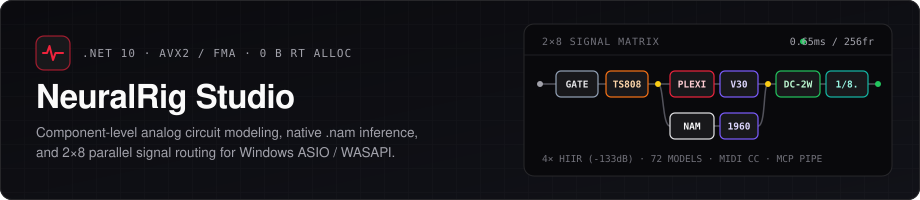

<div align="center">

<picture>
  <source media="(prefers-color-scheme: dark)" srcset="docs/assets/banner-dark.svg" />
  <source media="(prefers-color-scheme: light)" srcset="docs/assets/banner-light.svg" />
  
</picture>

<br />

[](https://github.com/srain0626/NeuralRigStudio/releases)
[](#quick-start)
[](LICENSE)

**English** · [한국어 (Korean)](README.ko.md)

[Quick Start](#quick-start) · [Audio & Presets](#universal-audio--first-run) · [Custom SPICE & MCP](#creating-custom-pedals-amps--cabinets) · [Benchmark Suite](#benchmark-suite) · [Cloud & OTA](#cloud-sync-gear-hub--ota) · [Build](#building-from-source)

</div>

---

**NeuralRig Studio** is a real-time guitar signal processor, physical MNA SPICE circuit simulator, and Neural Amp Modeler (`.nam`) host built in native C# (`.NET 10`, `AVX2`/`FMA`) with a WebView2 + React 19 interface.

All DSP kernels run inside the native managed audio thread with zero background Python runtime, enforcing **`0 B` heap allocation per audio callback block** across 4x HIIR polyphase oversampling, Newton-Raphson transistor/diode solvers, Koren 12AX7 triode preamps, symbolic KCL tone stacks, 16,384-tap Zero-Latency Partitioned FFT cabinet convolution, and `Vector256<float>` neural inference (`WaveNet`, `LSTM`, `ConvNet`).

> Maintainer: **Ray Kim** (`raykim@users.noreply.github.com`) · AI Agent Documentation Index: [AGENTS.md](AGENTS.md) · [llms.txt](llms.txt) · [docs/INDEX.md](docs/INDEX.md)

---

## Quick Start

### Option 1: Windows Installer (`Setup.exe`)
1. Download `NeuralRigStudio-v3.0.0-Setup-win-x64.exe` from [GitHub Releases](https://github.com/srain0626/NeuralRigStudio/releases).
2. Run the installer. It installs both `NeuralRigStudio.exe` and `NeuralRigMcp.exe` under `%LOCALAPPDATA%\Programs\NeuralRigStudio`, creates Start Menu / Desktop shortcuts, and registers clean Add/Remove Programs uninstall support.

### Option 2: Standalone Single-File Executable
1. Download `NeuralRigStudio-v3.0.0-win-x64-standalone.exe`.
2. Run directly with zero installation or external asset folders (web UI assets unpack cleanly on first launch into `%LOCALAPPDATA%\NeuralRigStudio\wwwroot_bundle`).

### First-Run Flow
1. **Account or Guest Mode**: On initial launch you may sign in with Google (unlocks Cloud Settings Sync and the Community Gear Hub) or click **Continue as Guest (Offline Mode)** to play locally with zero account required.
2. **Interactive Studio Tutorial**: A 6-step guided walkthrough highlights Audio I/O patching, 8 showcase presets (`1A`–`2D`), the 2x8 signal chain, AI Tone Architect, custom SPICE gear creation, and the Benchmark Suite. Click **GUIDE** in the header anytime to replay it.
3. **Connect Your Guitar**: Open **Audio I/O** (`Audio` sheet or Command Palette `/`) and select your ASIO driver (Focusrite, Steinberg, Audient, Behringer, Roland, Line 6, Valeton, etc.) or driverless WASAPI Line-In with Mono (`Ch 1..N`) or Stereo (`Ch 1/2`, `Ch 3/4`) channel mapping.

---

## Universal Audio & First-Run Showcase Presets

`AudioRouter` handles four universal driver topologies with zero vendor lock-in and automatic hardware interface prioritization:
- **ASIO Full-Duplex Direct (`AsioDirectDuplex`)**: Direct callback execution on a single hardware ASIO device.
- **ASIO Input -> Lock-Free SPSC Ring -> WASAPI Output (`Wasapi`)**: Routes any ASIO instrument interface to PC speakers/headphones using MMCSS `"Pro Audio"` priority (`4 ms` / `8 ms` / `16 ms` / `32 ms` ring latency profiles).
- **Driverless WASAPI Capture (`WASAPI` Line-In)**: Works without vendor ASIO drivers, supporting Windows Raw APO bypass (disables speech AGC/noise suppression) and `44.1 kHz <-> 48 kHz` zero-allocation windowed-sinc sample-rate bridging.
- **Dual-ASIO (`AsioOut`)**: Independent ASIO input and output hardware clocks.

Eight showcase presets are preloaded in banks `1A`–`2D`:

| Bank | Preset | Topology Summary |
|:---|:---|:---|
| `1A` | **Velvet Neo-Soul Clean** | SP Comp -> Jan Ray -> US Blackface Twin + 1x12 Jensen -> DC-2W -> Spring Reverb |
| `1B` | **Golden Edge of Breakup** | Orange Squeezer -> TS808 + Klon -> Brit 1Star -> Alnico Blue -> Plate Reverb |
| `1C` | **Brit 800 Arena Crunch** | Adaptive Gate -> SD-1 Boost -> JCM800 2203 -> 1960BV V30 -> Hall Reverb |
| `1D` | **Tokyo Anime Pop-Rock** | SP Comp -> BD-2 -> Parallel JC-120 + AC30 Split -> DD-3T Dotted 8th -> Hall |
| `2A` | **Tight Modern Djent** | Gate -> TS808 Boost -> 5150 III Red -> Mesa 4x12 + GE-7 Mid Cut |
| `2B` | **Cathedral Shimmer Wash** | SP Comp -> AC30 -> Alnico Blue -> CE-2 -> TimeLine Tape Delay -> blueSky Shimmer |
| `2C` | **LA Hot-Rod Brown Lead** | Gate -> EP Booster -> BE-100 Brown Eye -> 1960BV V30 -> Analog BBD Delay |
| `2D` | **Psychedelic '68 Fuzz** | Cry Baby Wah -> Ge AC128 Fuzz Face -> Plexi 100 -> Uni-Vibe -> Spring Tank |

Search inside the Signal Chain catalog matches both safe UI aliases (`Green Screamer 808`, `Brit 800 Lead`) and original hardware names (`Ibanez TS808`, `Marshall JCM800`) seamlessly.

---

## Creating Custom Pedals, Amps & Cabinets

When a guitar pedal, tube amp, or cabinet is missing from the built-in 75+ device catalog, you can add physical models directly via AI MCP agents or external files:

1. **Click `CRAFT` in the top bar** to open the interactive creation guide with copyable prompts and MCP snippets.
2. **Install `neuralrig-mcp` across your AI tools** in one command (supports Claude Desktop, Claude Code, Cursor, Windsurf, OpenAI Codex CLI, Gemini CLI, and Antigravity):
   ```bash
   npx -y neuralrig-mcp install --client all
   ```
   Verify installation & Studio pipe connectivity:
   ```bash
   npx -y neuralrig-mcp doctor
   ```
3. **5-Step AI Schematic Verification Pipeline**:
   - The AI inspects `neuralrig_get_spice_guide`, researches the authentic schematic and datasheet specs (stopping honestly if no verifiable schematic exists), registers missing semiconductor `.MODEL` parameters (`neuralrig_register_spice_model`), validates `.OP` DC operating points, `.AC` Bode sweep, `.TRAN` 4x harmonics, and `0 B` RT allocation (`neuralrig_simulate_spice`), and hot-deploys the device via `neuralrig_commit_spice_device`.
4. **External `.nam`, `.wav` IR, and `.nrig` Drop**: Drag and drop any `.wav` cabinet IR (up to 16,384 taps), `.nam` capture, or `.nrig` bundle directly onto the Studio window.

For detailed MCP tool schemas, see [docs/MCP_INTEGRATION.md](docs/MCP_INTEGRATION.md).

---

## Benchmark Suite

Click **BENCH** in the header (or run `RigBench.exe`) to run quantitative hardware, latency, and stability checks on your machine (`RigBenchmarkSuite.cs`):
- **Hardware Similarity (`98.2%` suite average verified via `RigBench`)**:
  - `Ibanez TS808` MNA SPICE `.AC` `720 Hz` mid-hump vs `100 Hz` (`97.6%`)
  - `BOSS SD-1` 3-diode asymmetric 2nd-harmonic (`H2=-23.6 dBc`) vs symmetric `TS808` (`-120.0 dBc`) (`99.2%`)
  - `Dallas-Arbiter Fuzz Face` PNP Germanium `AC128` MNA bias & THD (`98.5%`)
  - `Fender '65 Twin Reverb` 250V `12AX7` + `5-5-5` FMV tone-stack mid scoop `-9.7 dB` (`95.9%`)
  - `NAM WaveNet Feather` 64-frame vs 256-frame block-boundary invariance (`ESR=0.00E+000`, `100.0%`)
- **Real-Time Latency & `0 B` RT Deadline (`64` / `128` / `256` frames @ 48 kHz)**: Verifies average & P99 execution times remain far below buffer budget (`1.333 ms` at 64 frames) with `0 B` RT heap allocation.
- **16-Slot Multi-Chain Stress**: Full 16-slot Serial torture chain, 16-slot Parallel Dual-Amp Matrix, 4-Stage High-Gain `SoftKneeCeiling` overdrive stability, and MNA SPICE (x2) + 8,192-tap Partitioned FFT Cab IR stress run.

---

## Cloud Sync, Gear Hub & OTA

Optional public cloud services run on Vercel Next.js (`cloud/`) backed by Supabase (PostgreSQL + Google Auth PKCE):
- **Desktop Works Offline by Default**: Guitar playback, AI Tone Architect, SPICE engine, VST3/CLAP export, `.nrig` bundles, and benchmarks operate offline in Guest mode with zero network requirement.
- **Google OAuth & Sync**: Signing in opens the loopback browser flow (`http://127.0.0.1:<port>/callback`) to sync saved presets, guitar DI profiles, and custom SPICE gear across devices.
- **Community Gear Hub (`HUB · VST3 -> GEAR HUB`)**: Browse, filter, publish, and 1-click install community-authored SPICE circuits and cabinet IRs (validated client-side with `SpiceAnalyzer` before registration).
- **Automated Scrubbed Bug Reporting (`BUG`)**: Collects the most recent scrubbed logs from `LogSanitizer` (stripping Windows/Unix user paths, OS usernames, hostnames, and tokens) plus OS/SIMD diagnostics. Queues locally in `%AppData%\NeuralRigStudio\bug_reports_outbox.json` if offline.
- **Choice & Mandatory OTA (`OtaUpdateService`)**: Checks Cloud `/api/ota/check` with direct GitHub Releases fallback. Optional releases can be postponed (`Later`); releases flagged `forceUpdate` or below `minSupportedVersion` lock behind a mandatory update modal.
- **In-App Admin Console (`ADMIN`)**: Unlocked automatically for accounts listed in `NEURALRIG_ADMIN_EMAILS` / `profiles.is_admin`, displaying live analytics KPIs, scrubbed bug queues, and OTA choice/force policy controls.

To self-host `cloud/`, copy [cloud/.env.example](cloud/.env.example) to `cloud/.env.local`, apply [cloud/supabase/migrations/001_neuralrig_cloud.sql](cloud/supabase/migrations/001_neuralrig_cloud.sql) to Supabase, deploy `cloud/` to Vercel, and enter the URL in the **SIGN IN** dialog.

---

## Building from Source

Requirements: **.NET 10 SDK** (`net10.0-windows` desktop workload), **Node.js 20+**.

```bash
# 1. Build React frontend into wwwroot/
npm --prefix web-ui install
npm --prefix web-ui run build

# 2. Build solution & publish MCP binary
dotnet build NeuralRigStudio.sln -c Release
dotnet publish tools/NeuralRigMcp/NeuralRigMcp.csproj -c Release -r win-x64 --self-contained false -o bin/Release/net10.0-windows/win-x64/publish

# 3. Run standalone DSP/SPICE/Benchmark suite (must exit 0, RT alloc: 0 B)
./tools/RigBench/bin/Release/net10.0-windows/RigBench.exe
```

To generate release binaries (`dist-release/NeuralRigStudio-v3.0.0-Setup-win-x64.exe`, `dist-release/NeuralRigStudio-v3.0.0-win-x64-standalone.exe`, and `SHA256SUMS.txt`):

```powershell
powershell -ExecutionPolicy Bypass -File scripts/build-release.ps1
```

## Contributing & Security

- Contribution guide: [CONTRIBUTING.md](CONTRIBUTING.md)
- Vulnerability reporting & PII policy: [SECURITY.md](SECURITY.md)
- License: [MIT License](LICENSE) — Copyright (c) 2026 Ray Kim
