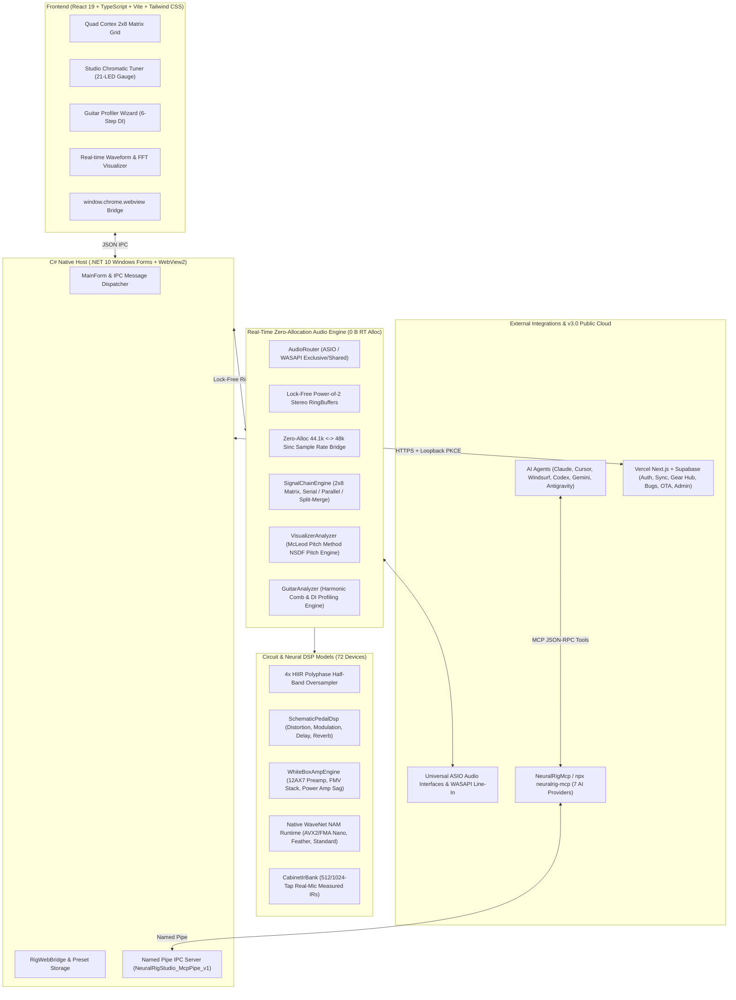
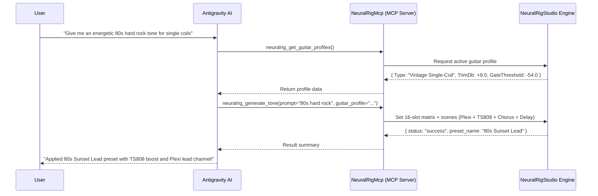

# NeuralRig Studio Architecture

NeuralRig Studio is a pure native C# (.NET 10 + WebView2 + AVX2/FMA) real-time guitar multi-effects, amp modeling, and neural rig studio with full Antigravity AI MCP integration.

---

## 1. Zero-Allocation Real-Time Audio Engine

The real-time audio thread in NeuralRig Studio is strictly bounded to **0 Bytes per processing block** (`RT alloc: 0 B`), running at sub-millisecond execution times within a typical 5.80 ms budget (256 samples @ 44.1/48 kHz).

### Key Characteristics
- **Pre-Allocated Memory Pools**: All audio buffers, intermediate ping-pong buffers, oversampling stages, and state vectors are allocated upon device initialization.
- **Lock-Free Ring Buffers**: Uses power-of-2 circular buffers with memory barriers (`Volatile.Read` / `Volatile.Write`) for inter-thread communication between the ASIO/WASAPI driver callback, UI visualizer, and tuner threads.
- **Zero-Alloc Sample Rate Converter**: When bridging 44.1 kHz USB hardware with 48 kHz system output or vice-versa, a pre-calculated sinc interpolation filter converts stream rates with zero runtime heap allocation.
- **SIMD Acceleration**: Core math, vector arithmetic, and neural network matrix multiplications utilize hardware-accelerated AVX2 and FMA instructions (`System.Runtime.Intrinsics.X86`).

---

## 2. DSP Signal Chain & Circuit Modeling

NeuralRig Studio includes 72 schematic-modeled devices spanning 10 categories, modeled after legendary analog pedals, tube preamps, and speaker cabinets.

### Signal Chain Topology
- **Quad Cortex Inspired 2x8 Matrix**: Two stereo paths (Rows 1 and 2), each holding up to 8 slots (16 processing blocks total).
- **Flexible Routing**: Supports pure serial (Row 1 -> Row 2), split-parallel (Row 1 splits to Row 2, then recombines), or dual discrete stereo paths.
- **8 Scenes per Preset**: Instantaneous, click-free parameter morphing and slot bypass switching without reinitializing DSP instances.

### Analog Modeling Stages
1. **4× HIIR Oversampling**: Multi-stage polyphase half-band IIR filtering eliminates digital aliasing in non-linear clipping stages while keeping phase distortion imperceptible.
2. **Schematic Diode Distortion Physics**: True non-linear equations for symmetric clipping (TS808, OD-1, Pure Sky) and asymmetric clipping (SD-1, Jan Ray, Boss BD-2), producing accurate 2nd and 3rd harmonic spectra.
3. **Multi-Stage 12AX7 Vacuum Tube Preamp**: Progressive grid conduction, plate saturation, cathode degeneration, and Miller capacitance emulation.
4. **Passive FMV & James Tone Stacks**: Exact 4-node matrix circuit modeling with interactive Bass, Middle, and Treble potentiometers.
5. **Power Amp Dynamics**: Dynamic power supply voltage sag, envelope-dependent compression, Presence negative feedback loop, and Depth resonant dampening.
6. **Cabinet Impulse Response Engine**: Low-latency direct-convolution engine loaded with measured IRs (Mesa 4x12, Marshall 1960A, Marshall 1960BV, Fender Jensen 1x12, Roland JC-120 2x12, Celestion Alnico, and V30).

---

## 3. Guided Guitar DI Profiler

The Guitar Profiler analyzes the user's direct instrument (DI) signal using a 6-step guided calibration wizard:
1. **Silence / Noise Floor**: Measures ambient room noise, pickup electromagnetic interference, and 60 Hz / 50 Hz mains hum via a trimmed-mean band-limited filter.
2. **Open Low E (E2, ~82.4 Hz)**: Analyzes low-frequency resonance, baseline sustain, and pick attack transient.
3. **Open D (D3, ~146.8 Hz)**: Evaluates mid-low body and core instrument resonance.
4. **Open B (B3, ~246.9 Hz)**: Analyzes upper-mid sweetness and string tension.
5. **Open High E (E4, ~329.6 Hz)**: Measures high-frequency clarity, harmonic decay, and treble cutoff.
6. **Full Strum Dynamic Test**: Captures peak transient headroom, dynamic range (dBFS), and harmonic richness using an 8192-point zero-padded FFT harmonic comb.

### Profiling Outputs
- **Pickup Classification**: Auto-classifies pickups into *Vintage Single-Coil*, *Modern Single-Coil / P90*, *Vintage Low-Output Humbucker*, or *High-Output Modern Humbucker*.
- **Suggested Input Trim**: Automatically calculates the optimal preamp gain boost or pad (dB) to place guitar transients into the analog sweet spot.
- **Suggested Noise Gate Threshold**: Sets an adaptive threshold just above the measured noise floor to eliminate idle hum without choking musical sustain.

---

## 4. Studio Chromatic Tuner

Powered by the **McLeod Pitch Method (MPM)** with Normalized Square Difference Function (NSDF):
- **Pitch Range**: Full guitar frequency range (E2 @ 82.4 Hz to E4+ @ 330+ Hz) with sub-octave anti-jump filtering for weak Stratocaster neck-pickup fundamentals.
- **Precision**: Cent deviation accuracy within ±0.5 cents.
- **Visuals**: 21-LED retro-style meter with analog needle dampening and cent readout.
- **Calibration**: Adjustable A4 reference frequency (420 Hz to 460 Hz, default 440 Hz).
- **Lock-Free Tuner Mute**: Seamless, click-free audio muting on the real-time thread during stage tuning.

---

## 5. Antigravity AI MCP Integration

NeuralRig Studio runs an out-of-process Model Context Protocol (MCP) server (`tools/NeuralRigMcp`) connecting Antigravity to the live DSP engine via high-speed Windows Named Pipes (`\\.\pipe\NeuralRigStudio_McpPipe_v1`).

