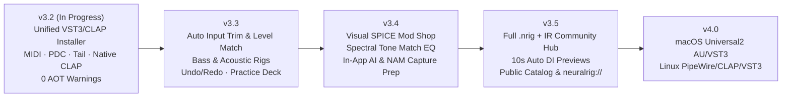

# NeuralRig Studio Engineering Roadmap (v1.1 – v4.0)

This roadmap tracks shipped architecture milestones and planned engineering work across core DSP, DAW plugin targets (VST3 / CLAP), packaging, desktop practice tools, and cloud services.

All runtime changes remain bound to the non-negotiable real-time audio contract: **`0 B` managed heap allocation** and zero locks on every audio callback thread, verified by `RigBench.exe`, `Vst3HostVerify.exe`, and `ClapHostVerify.exe`.

---

## Shipped Baseline (v1.1 – v3.1.0)

| Version | Milestone | Key Deliverables |
|:---|:---|:---|
| **v1.1** | Modular Core & Live Control | Split `NeuralRig.Core`, global BPM + tap tempo, MIDI CC/PC Learn, model alias + original name resolution, windowed-sinc resampler. |
| **v1.2** | Multi-NAM & Cab Studio | 3 concurrent independent `.nam` slots (`WaveNet` / `LSTM` / `ConvNet`), zero-latency 16K-tap uniformly partitioned FFT convolver, dual-mic Virtual Cab Room. |
| **v1.3** | Polyphonic Pitch & Pool Expansion | `PolyPitchEngine` (`1024`-pt STFT phase vocoder: Virtual Capo, Whammy, Octaver), 4-slot dynamic amp/cab/delay/reverb pools inside the `2x8` matrix. |
| **v1.5** | Recording, Re-amping & Looper | `DualStreamRecorder` (`Dry DI + Stereo Wet` WAV), one-click live DI re-amping, BPM-synced stereo looper. |
| **v2.0** | Ecosystem, MNA SPICE & Plugin Kernel | SHA-256 `.nrig` bundle archive, `NeuralRig.Plugin` (160 DAW parameters), schematic/datasheet MNA SPICE solver (`.OP`/`.AC`/`.TRAN`, max 36 nodes/stage). |
| **v3.0** | Cloud Backend, `npx` MCP & OTA | `cloud/` Next.js 15 + Supabase RLS backend, Google OAuth loopback PKCE + guest mode, `SPICE GEAR HUB`, `LogSanitizer` 400-line ring bug reporting, optional/forced OTA, `npx neuralrig-mcp` wrapper. |
| **v3.0.1** | Minimalist Workspace UI | Silver-Mist / Obsidian Night studio layout, bottom dock (`Audio · Record · Menu`), `?` hover tooltips, strict list ellipsis truncation. |
| **v3.1.0** | Native VST3 GUI & Dual I/O Metering | `.NET 10 NativeAOT` C-ABI (`NeuralRig.NativeCore.dll`) + C++20 COM `IPlugView`/WebView2 shell, always-visible `-24..+24 dB` I/O gain strip, logarithmic `-60..0 dBFS` stereo meters, click-to-clear `IN PEAK` / `OUT PEAK` latches, `I/O Lock` across preset changes. |

---

## Current Audit Summary (Post-v3.1.0)

1. **DAW Compatibility**: `src/NeuralRig.Vst3Native/vst3_plugin.cpp` lacked `kEvent` MIDI input bus + `IMidiMapping`, hardcoded `getLatencySamples() = 0` (preventing DAW PDC when `PolyPitchEngine` runs) and `getTailSamples() = 0` (truncating offline bounces), and did not synchronize LFO phases with DAW transport play/seek state. Native C++ `.clap` entry was not yet wired to a C++ host shell with Win32 WebView2 GUI.
2. **Packaging & AOT Hygiene**: `CloudPlatformService.cs` relied on reflection-based `JsonSerializer` (`IL2026`/`IL3050` warnings under `PublishAot=true`). `NeuralRigSetup` and `build-release.ps1` packaged only standalone `NeuralRigStudio.exe` + `NeuralRigMcp.exe`, forcing DAW users to manually extract plugin zips on every OTA update.
3. **Practice, Calibration & Catalog Depth**: `cortexCatalog.ts` currently covers electric guitar rigs (`11` amps, `8` cabs, `50+` pedals) with no dedicated bass/acoustic amps or IRs, no one-click pickup calibration (`-6 dBFS` target), no optional loudness matching across presets, and no global chain Undo/Redo or A/B compare.
4. **Community & Differentiation**: MNA SPICE authoring is MCP/JSON-driven with no visual schematic component-swapping UI in-app, no spectral tone-matching FIR generator, and `hub_gears` only stores single SPICE specs rather than full `.nrig` presets or Web audio previews.

---

## Upcoming Releases

### v3.2 — Zero-Friction DAW & Production Reliability
**Target Scope:**
- **NativeAOT Clean Cloud Service**: Convert all JSON serialization/deserialization in `CloudPlatformService.cs` to source-generated `NeuralRigJsonContext` / `NeuralRigIndentedJsonContext` (`0` `IL2026` / `IL3050` warnings across all solutions). Expose `getCommunityHub` and `installCommunityGear` inside VST3/CLAP plugin UI.
- **VST3 Specification Completion (`src/NeuralRig.Vst3Native/`)**:
  - Add `kEvent` MIDI input bus (`16` channels) and `IEditController::IMidiMapping` routing CC `1`/`4`/`11` (Wah / Whammy / Drive), CC `7` (Output Gain), and Program Change (`0..7` → Scenes `1..8`) on the RT thread with `0 B` allocation.
  - Report dynamic PDC via `IAudioProcessor::getLatencySamples()` (`1024` samples when any poly-pitch slot is active; `0` otherwise) and reverb/delay tail length via `getTailSamples()`.
  - Synchronize modulation LFO phases with DAW transport `kPlaying` / `kProjectTimeMusicValid` beats on playback start or timeline jump.
- **Native CLAP v1.2 Plugin (`src/NeuralRig.ClapNative/`)**:
  - Bundle official MIT `free-audio/clap` C headers and implement `clap_entry` + `clap_plugin_audio_ports`, `clap_plugin_note_ports` (MIDI), `clap_plugin_params` (`160` params), `clap_plugin_state`, `clap_plugin_latency`, `clap_plugin_tail`, and `clap_plugin_gui` (`CLAP_WINDOW_API_WIN32` WebView2), sharing `NeuralRig.NativeCore.dll`.
  - Verify end-to-end with headless/GUI `ClapHostVerify.exe` (`scripts/build-clap.ps1`) and expanded `Vst3HostVerify.exe` + `RigBench.exe` checks.
- **Unified Installer, CI/CD & Docs**:
  - Bundle `NeuralRigStudio.vst3` and `NeuralRigStudio.clap` into `NeuralRigSetup.exe` (`%LOCALAPPDATA%\Programs\Common\{VST3,CLAP}` per-user install with UAC-free silent OTA overwrite) and `installer/NeuralRigStudio.iss`.
  - Integrate VST3/CLAP builds and `--no-gui` native host verification into `scripts/build-release.ps1` and `.github/workflows/release.yml`, add Authenticode signing hook, and sync `README.md` / `README.ko.md` to `v3.2.0`.

### v3.3 — Daily Guitar/Bass Practice & Stage Readiness
**Target Scope:**
- **One-Click Auto Input Calibration & Preset Loudness Matching**:
  - `AUTO` button in the top I/O bar measures peak transient level over a short strum window and sets `InputGainDb` to target `-6 dBFS` headroom.
  - Optional Auto-Leveling / True-Peak Brickwall Ceiling mode alongside `SoftKneeCeiling` to eliminate jarring volume jumps across patches.
- **Bass & Acoustic Rig Expansion**:
  - Tube bass preamp/power models (`SVT-CL` style), parallel clean-low/driven-high crossover bass preamp (`B7K` topology), DI box voicing, `8x10` & `4x10` measured bass cab IRs.
  - Dreadnought, OM, and Nylon acoustic body IRs + body-resonance notch EQ for piezo pickups.
- **Workflow & Practice Tools**:
  - Global chain Undo/Redo stack (`Ctrl+Z` / `Ctrl+Y`), A/B patch snapshot toggle, slot copy/paste.
  - Enhanced backing-track deck (A-B loop markers, independent pitch/speed control, built-in tempo-synced metronome / groove pulse) and fullscreen high-contrast Stage HUD + Setlist switcher.

### v3.4 — Visual SPICE Mod Shop, Tone Match & In-App AI
**Target Scope:**
- **Interactive SPICE Schematic Viewer & Mod Shop**:
  - Render `SpiceCircuitDto` topology as an interactive SVG schematic inspector allowing one-click component swaps (e.g., `1N914` vs `LED` vs `1N34A Ge` diodes, coupling caps, cathode bypass values) backed by live `.AC` magnitude + `.TRAN` harmonic plots from `SpiceAnalyzer` and instant hot-reload at `0 B` RT allocation.
- **Spectral Tone Match EQ Block**:
  - Capture target tonal curve from a reference audio stem vs. player DI recording and synthesize a minimum-phase FIR matching IR executed by the existing `PartitionedConvolver` (`0 B` RT allocation).
- **In-App Conversational Tone Engineer & NAM Capture Prep**:
  - Integrated AI chain-tuning drawer extending `AntigravityToneArchitect` (plus optional BYOK LLM providers) and a guided re-amp sweep capture exporter compatible with standard NAM training pipelines.

### v3.5 — ToneCloud Community Ecosystem & Growth Flywheel
**Target Scope:**
- **Full Preset (`.nrig`) & User Cab IR Hub**: Extend `hub_gears` schema to index complete signal chain bundles (`.nrig`), user cab IRs, and modded SPICE pedals, paired with automated 10-second reference-DI audio previews generated before upload.
- **Public SSR Catalog & Deep Linking**: Search-indexed `https://neuralrigstudio.seltum.xyz/hub` browsing page with `neuralrig://install/<id>` custom URI handler for one-click desktop/plugin import.

### v4.0 — Cross-Platform Native Targets
**Target Scope:**
- Decouple the WinForms/Win32 host shells to add **macOS Universal2** (`CoreAudio`, `WKWebView`, AUv2/VST3/CLAP) and **Linux** (`PipeWire`/`JACK`, `WebKitGTK`, CLAP/VST3), sharing `NeuralRig.Core`, `NeuralRig.Plugin`, and `web-ui/`.
